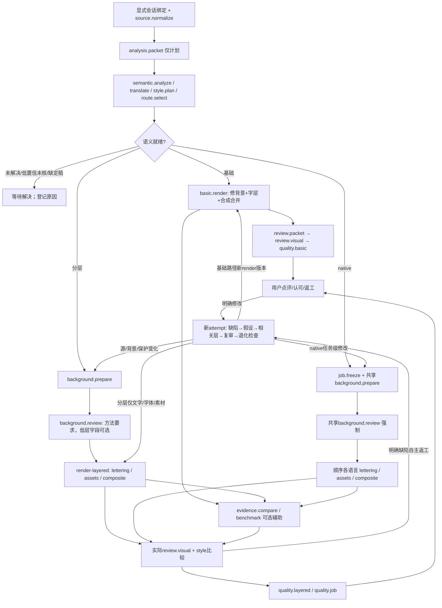

# 本地流程节点与产物清单（设计输入，未改实现）

调查时间：2026-11-02。范围：项目工作流、CLI、核心 Python、少量真实 runs/work JSON；未调用制作/质量命令、未看凭证或会话日志、未修改真实产物、未调用付费 API。本文区分源码合同、历史回执与建议模型；没有重新运行旧门禁或重新做视觉审核。

## 1. 事实边界与状态词

- [AGENTS](../AGENTS.md)、[单图流程](../agent/workflows/single-image.md)、[五阶段方法](../knowledge/methods/layered-localization.md)要求：语义样式 → 去字背景单独审核 → 透明目标字层 → 合成 → 全图适配审核；这是 Agent 的执行要求，不能当作所有 CLI 已自动实现。
- [packet](../src/image_localizer/pipeline.py#L71)的 `workflow_stages`（analyze-style/clean-background/target-lettering/composite/adapt-review）是**计划节点**；工作包生成不执行识字、翻译、看图或审核。
- 建议统一进度：`planned`、`observed/running`、`artifact_ready`、`review_pending/completed`、`failed/unknown`。completed只表示本次真实审核动作完成，另存verdict；不能把审核完成理解为通过。observed用于有可验证历史执行证据；running只来自实时显式事件，不能从mtime、目录或旧timing猜测。
- 节点至少拆为 `execution_status`、`artifact_status`、`review_status`、`verdict`、`binding_status`；技术pass、Agent质量、用户认可独立。阻塞原因如unresolved、缺背景审核、哈希过期要明确显示。
- 后端以**显式 sessionId + runRoot**绑定流程与原会话；源hash只关联证据/图组，不决定会话归属。当前项目JSON不含可信原会话身份，不能扫描会话日志补猜。

## 2. CLI动作 → 实际节点 → 产物 → 门禁

入口 [bin/it.py](../bin/it.py#L1)仅导入 [cli.main](../src/image_localizer/cli.py#L85)。下表ID为建议的跨分支稳定类型，实例另需attempt/language/region。

| 实际动作 / 函数 | 建议节点类型 | 实际产物与执行含义 | 真实状态 / 门禁 |
| --- | --- | --- | --- |
| doctor → [cli.doctor](../src/image_localizer/cli.py#L22) | `capability.inspect` | stdout：Python/Pillow/RAQM/候选字体、能力边界 | 不证明宿主已看图或外部服务已验证；通常无持久回执 |
| init → [initialize](../src/image_localizer/pipeline.py#L34) | `source.normalize`, `task.initialize` | 规范化source PNG、空语义清单；原始SHA和规范化SHA分开 | 单帧、EXIF方向、≤50MP、新run；analysis.complete=false |
| init-job → [initialize_job](../src/image_localizer/jobs.py#L36) | `job.initialize` | 顶层源图、job计划、各语言源图/语义清单 | 1..20安全不重复语言、新目录；pending；不识字 |
| packet → [packet](../src/image_localizer/pipeline.py#L71) | `analysis.packet` | packet：提示词、知识、源hash、manifest快照、五阶段计划 | load_run ready=false；计划不是运行 |
| Agent实际看图/识字/翻译/定角色/选路 | `semantic.analyze`, `semantic.translate`, `style.plan`, `route.select` | analysis/regions/glossary/protections；visual_targets、rows/assets/region_map | 无专门CLI和开始/结束事件；声明及校验不能证明已观察 |
| validate → [load_run](../src/image_localizer/pipeline.py#L61), [validate_manifest](../src/image_localizer/contracts.py#L50) | `semantic.validate` | stdout valid/advisories；不写独立验证报告 | 源hash/尺寸/字段/区域冲突/定稿/置信/complete/unresolved；成功不是视觉通过 |
| render基础 → [render](../src/image_localizer/pipeline.py#L102), [render_image](../src/image_localizer/rendering.py#L216) | `basic.render`（合并执行） | 新版本translated/text-layer/comparison/layout/receipt、current指针、初始quality | 同次修背景+排字+合成；没有独立clean输出/背景审核；needs_review、初始technical=pass/quality=pending |
| review-packet → [review_packet](../src/image_localizer/pipeline.py#L166) | `review.packet` | 当前空review-template；stdout证据/提示词路径 | current_render重算绑定；模板不等于review已运行 |
| Agent基础自审/独立审 → 当前review | `review.visual` | 区域五项、全局两项、notes/issues、reviewer/kind | manifest/output hash、完整区域覆盖；未执行quality前不推最终gate |
| quality → [quality](../src/image_localizer/pipeline.py#L199) | `quality.basic` | run和版本quality | 缺review pending；false/major/critical fail；非法/过期hash technical fail；未核advisories pending；用户not_recorded |
| prepare-layered → [prepare_layered](../src/image_localizer/layered.py#L134) | `background.prepare` | source/background/edit-mask/background-plan/repair-layout/receipt | 源/背景key、mask外及保护像素变化=0；pending等待实际审背景 |
| 实际背景审核 → [verify_background_review](../src/image_localizer/stage_review.py#L10)消费 | `background.review` | background-review；native有模板，普通layered未统一生成 | source/background/receipt三SHA，三检查true、署名/kind、观察；仅minor允许；普通layered仅plan声明该路径时强制 |
| render-layered → [render_layered](../src/image_localizer/layered.py#L191) | `lettering.render`, `assets.compose`, `composite.render`（同次调用子节点） | text/effects/asset/overlay及预览/合成/mask/source/background/plan/layout/模板/receipt | 背景receipt/key、输入产物hash、字体素材/溢出/保护；technical pass仍pending；保护失败留输出并fail |
| check-layered → [check_layered](../src/image_localizer/layered.py#L293) | `quality.layered` | 返回值；**不写quality文件** | 重算全部输入/产物；review绑定output/plan、六检查、四stage_notes、advisories、style比较；缺review pending |
| prepare-job → [prepare_job](../src/image_localizer/jobs.py#L99) | `job.freeze`, `background.prepare` | 内容寻址inputs、冻结semantics/job/每语plan、共享background、bundle、空背景审核模板 | [加载](../src/image_localizer/jobs.py#L56)要求语义就绪/语言画布源一致、visual_targets非空、region_map完整、共享保护；pending停在背景待审 |
| render-job → [render_job](../src/image_localizer/jobs.py#L242) | `job.render` + 每语三子节点 | 每语layered；job-render绑定prepared/bundle/背景审核hash/语言清单 | 先verify_bundle+背景审核+背景receipt，再**顺序**各语言；任何语technical fail汇总fail，其他pending；异常可部分完成且无job-render |
| check-job → [check_job](../src/image_localizer/jobs.py#L266) | `quality.job` + 每语quality | 返回各语；**不写quality文件** | 冻结依赖/背景审核/语言清单/plan/semantics一致；fail优先、后pending/pass；user_acceptance始终not_recorded |
| font-check → [check_font_coverage](../src/image_localizer/lettering.py#L39) | `font.coverage` | stdout cmap覆盖/缺字U+；render内部也执行 | 映射不等于整形/视觉正确；RAQM及预算另阻断 |
| compare → [build_comparison/_emit](../src/image_localizer/evaluation.py#L205) | `evidence.compare` | board/regions局部板/differences RGBA mask/spec/模板/report | spec/源候选文件及像素hash；保护变化决定technical；visual/status固定pending；无读取填写review放行命令 |
| benchmark → [run_benchmark](../src/image_localizer/evaluation.py#L272) | `evidence.benchmark` + 每例compare | 每例比较/总report；已知缺陷标签 | technical_expectations仅核expected_technical；预期fail命中也算expectations pass；视觉始终pending |
| demo → [demo](../src/image_localizer/cli.py#L31) | `demo.author` + 基础路径 | synthetic source/clean/manifest/packet/render/模板/quality | 已知自制文案；未填review仍pending，不代表真实图片自动通过 |
| review-desk → [ReviewDesk/Handler](../src/image_localizer/review_desk.py#L66) | 发现/点评/返工辅助 | 任务投影/追加反馈/评估/返工prompt | 当前不是执行器或全阶段实时事件流；详见第6节 |

[CLI退出码](../src/image_localizer/cli.py#L174)：quality/check-layered/check-job：pass=0、pending=2、fail=1；一般异常status=error退出1；render退出0仍可能needs_review/pending；compare技术fail、benchmark期望不符退出1。exit0不能映射最终质量pass。

## 3. 分支图与语义/视觉门禁

- [语义门禁](../src/image_localizer/contracts.py#L59)：complete=true且observations非空；unresolved空；region非空或明确no_text_verified；confidence<0.9需recognition_verified；translate/preserve都需原文；保留理由/定稿/样式/repair完整；冲突矩形拒绝。unresolved是analysis字段，**不是region.action枚举**。
- [region_map](../src/image_localizer/job_content.py#L58)：每translate region、实际row、text/compound asset恰好引用一次；row.text + 位图声明text按序对齐target_text。仅NFC、空白和`，。、；`规范化；数字/ASCII标点/百分号严格。位图text只是声明，需看图核字；decoration不能冒充译文。
- [共享保护](../src/image_localizer/job_content.py#L113)：项目保护+每语manifest保护+preserve regions的bbox合并；不能只显示当前语言自己的保护。
- [背景路线](../src/image_localizer/layer_ops.py#L138)：solid / sample_rows / restore；另有外部background.path+mask（同画布/L蒙版）。sample_rows无有效donor报错；没有自动通用修复/真正原图编辑API。
- [字层路线](../src/image_localizer/lettering.py#L346)：rows不含effects用legacy paint，effects={}启用新管线；face/gradient、shadow/contact/depth/highlight、glyph-mask供检查，不是独立已审阶段。assets text/compound/decoration按序叠文字之上；compound不等于可编辑纯字层。
- [样式比较](../src/image_localizer/visual_review.py#L27)：源要求不得改写；target_observation/verdict/当前hashed evidence齐；源图+目标/对照/view证据必需；fail阻断，uncertain/空观察pending。基础quality不强制这套字段，旧layered计划也可无visual_targets；旧pass不可升级。
- [返工方法](../knowledge/methods/visual-fidelity-self-review.md#L55)：无需等用户才修可见缺陷；新候选保留旧失败；同因两轮无改善换路线/说明缺口。只改字层可复用未变背景；变化重算hash并重审受影响节点。

## 4. 真实JSON样本：只确认记录，不重新宣判

| 样本 | 实际结构与可证明事实 | 不可推断 |
| --- | --- | --- |
| [基础manifest](../runs/desktop-1-zh-20261029/manifest.json)、[receipt](../runs/desktop-1-zh-20261029/renders/20261029T080853-34ccfff4/receipt.json)、[quality](../runs/desktop-1-zh-20261029/quality.json) | complete=true/unresolved=[]；receipt needs_review且四产物hash；quality技术pass/视觉fail，major矩形补丁 | 技术pass不能认可还原；receipt不随后来quality改变 |
| [work分层receipt](../work/layered-cli-check/render/receipt.json) | stage=render、technical=pass、status=pending、保护0、多图层hash | 不可推五阶段通过 |
| [KFC背景receipt](../runs/kfc-zh-20261029/background-v3/receipt.json) | stage=background、background_key、mask外及保护0、pending | 像素门禁不等于残字/接缝视觉审核 |
| [native job](../runs/navermap-five-prepared/job.json)、[bundle](../runs/navermap-five-prepared/bundle.json)、[背景审核](../runs/navermap-five-prepared/background-review.json) | 输入内容寻址/逐语plan/semantics；真实署名self与minor；审核三hash | 未重新verify不称当前gate通过 |
| [job-render](../runs/navermap-five-render/job-render.json)、[日语receipt](../runs/navermap-five-render/ja/receipt.json)、[日语review](../runs/navermap-five-render/ja/review.json) | 五语有序清单；technical pass仍pending；review六检查/四stage_notes/style比较/minor | check-job无持久回执；review全true不能证明check运行过 |
| [demo历史quality](../work/demo-refined/run/renders/20261029T074852-39595298/quality.json) | 历史self pass，用户not_recorded | 示例不等于任意真实图能力 |
| [手工纹理verification](../work/texture-repair-trial/final-verification.json) | best_candidate、自定义mask/保护统计、sha256、source/baseline | 无标准stage/receipt/review状态，不能自动归为背景审核通过 |

**源身份陷阱**：[layered._image](../src/image_localizer/layered.py#L31)转RGBA后重存source副本，文件字节可能变化。真实native源 `bbb19d…` 与产物source副本 `799f77…` 不同，work分层源 `dd2ed3…` 与副本 `cc7683…` 不同。分开保存 `logical_source_sha256`（已验证plan/manifest source+receipt输入）、`artifact_sha256`（当前图字节）。[现有group_id](../src/image_localizer/review_groups.py#L11)按副本hash归组，可能拆开同图；不要拿它作session归属，也不要无依据合并不同hash。

## 5. 稳定node IDs与artifact selectors建议

类型ID不含中文名、路径或状态；实例key：`flowId/nodeType/scopeId/attemptId`，scopeId为shared、language或稳定regionId。flowId由显式sessionId/runRoot绑定生成；新候选新attemptId，复用背景用uses边引用旧实例，不复制旧pass。

核心类型：`task.initialize`, `job.initialize`, `capability.inspect`, `source.normalize`, `analysis.packet`, `semantic.analyze`, `semantic.translate`, `semantic.resolve`, `semantic.validate`, `style.plan`, `route.select`, `job.freeze`, `job.render`, `background.prepare`, `background.review`, `font.coverage`, `basic.render`, `lettering.render`, `assets.compose`, `composite.render`, `review.packet`, `review.visual`, `quality.basic`, `quality.layered`, `quality.job`, `evidence.compare`, `evidence.benchmark`, `feedback.user`, `revision.request`, `revision.dispatch`, `revision.attempt`。

每产物字段：`artifactId, nodeInstanceId, role, mediaType, selector, resolvedRelativePath, sha256, expectedSha256, bindingStatus, language, regionId?, dimensions?, createdByOperation?, declaredOnly, provenance`。selector是后端许可选择器，不接受浏览器任意路径；JSON可选fragment、图片可选bbox。缺失/过期/未验证/不支持分别报告。

| role / selector | 真实来源及限制 |
| --- | --- |
| `source.normalized` | run/source或冻结job.source；逻辑源hash和原文件hash分开 |
| `semantic.manifest`, `semantic.region`, `semantic.unresolved` | live manifest或绑定冻结semantics；regions[id]/analysis.unresolved片段；区分live与receipt绑定快照 |
| `style.targets`, `route.plan`, `semantic.region-map` | job/plan字段；notes手工依据标声明，计划不等于执行 |
| `background.clean`, `background.mask`, `background.layout`, `background.review` | 背景receipt许可清单；native经prepared/bundle追共享背景；基础只有clean SHA无路径不能猜相邻文件 |
| `lettering.text`, `lettering.effect:<name>` | 当前receipt text-layer/effects-*；空透明组件标为空，不证明用了该效果 |
| `assets.layer`, `assets.input:<assetId>`, `overlay`, `overlay.preview` | receipt+已验证plan/inputs；text/compound需声明文字并实际核字 |
| `composite.output`, `composite.layout`, `composite.mask` | translated/layout/allowed-edit-mask；基础没有独立background/mask显示不产出 |
| `comparison.full`, `comparison.zoom` | comparison/view；基础comparison会thumbnail，不保证原尺寸；layered双图原尺度、view按view_scale放大 |
| `review.template`, `review.record`, `quality.report` | 当前绑定文件/可追溯gate返回；check-layered/job无quality文件不能伪造已运行 |
| `evaluation.board`, `evaluation.roi:<id>`, `evaluation.diff:<candidateId>`, `evaluation.report` | compare/benchmark report许可路径+hash；现desk assets不支持独立证据 |
| `feedback.record`, `revision.request` | 小型追加记录，绑定节点实例/源/语义/plan/产物hash/feedbackId；发原会话另需session绑定 |

## 6. 现有工作台动作与显式事件缺口

[ReviewDesk.discover](../src/image_localizer/review_desk.py#L111)只发现render receipts和未消费manifest（runs/work）；忽略background receipt独立任务，也不按job/bundle生成全流程。无产物layered plan、共享背景待审、部分语言完成缺少完整投影。当前task只提取region id/action/source/target/bbox/notes，丢失analysis.unresolved/confidence/visual_targets/region_map等。

| HTTP动作（[dispatch](../src/image_localizer/review_desk.py#L419)） | 当前责任 / 设计影响 |
| --- | --- |
| GET bootstrap / tasks / task detail | 项目身份、分组、产物/时间；无原会话绑定/节点事件 |
| GET assets | 仅已发现task._images许可图片；不直接展示解析JSON、background-only、compare板 |
| GET monitor | [snapshot](../src/image_localizer/project_monitor.py#L277)：有界文件投影、5秒cache；不执行质量/模型/benchmark，不等于running |
| POST task feedback | [append_feedback](../src/image_localizer/review_desk.py#L295)：approved/changes_requested/comment、区域意见、源/译稿/输出三hash并发校验；无输出不能认可；小型追加记录 |
| GET revision-prompt | [revision_instruction](../src/image_localizer/review_groups.py#L54)：只用最新匹配三hash已保存意见；comment/changes actionable；approved不沿旧返工；只生成指令 |
| POST monitor evaluations | [append_evaluation](../src/image_localizer/project_monitor.py#L519)：五维评分/说明、追加保存、三hash冲突检查；不是节点执行/用户认可 |

[monitor._task](../src/image_localizer/project_monitor.py#L379)只投影部分hash及历史quality；Agent状态只接受self review+quality匹配，independent不计入同一self统计。check-layered/job没有保存quality时可呈unknown；应展示证据差异，不倒填pass。

建议显式事件（后续实现，本次未实现）：

1. `flow.bound`：sessionId/runRoot/flowId/语言/branch，原会话来自可信宿主上下文；图片文字/路径不能赋予会话路由权。
2. `node.planned / started / artifact_published / finished / failed`：operationId/attemptId/parent/scope、输入产物hash、时间、错误/partial outputs。原子发布才artifact_ready；无started不画running。
3. `semantic.unresolved / resolved`、`route.selected`、`review.requested / recorded`、`gate.evaluated`：具体原因、观察文件/尺度/region、reviewer/kind、绑定/verdict。手工识字翻译看图需Agent显式报告。
4. `background.reused / invalidated`：共享实例及background_key/receipt/review身份。字变只失效相应下游；源/背景/保护变回prepare；不能按目录名继承pass。
5. `job.language.started / finished / failed`：顺序多语中断、部分完成、未开始分开；job-render缺失不代表前面未执行。
6. `feedback.saved`、`revision.requested / dispatched / failed / acknowledged / linked`：每节点可点评且绑定当时实例/产物；保存和派发分开；发原会话失败保留草稿/复制请求；新attempt显式parentRevision/feedbackId，不能从v2目录猜因果。
7. `flow.paused / resumed / cancelled`与输入等待原因：当前无可靠事件，历史unknown；gate失败、异常、缺证据、用户修改分别显示。

[production_timing](../src/image_localizer/production_timing.py#L37)仅包basic render/prepare_layered/render_layered/render_job；**finally结束时才写**completed/failed，失败journal可能在隐藏.render-timings，含partial hashes；不是实时开始事件，也不计识字/翻译/看图/人等待。prepare-job/check/compare无同等全程计时。不能为补历史重跑命令或扫会话日志。

存储：大产物留原处，仅保存小型session绑定、节点事件、产物索引/哈希、点评/派发回执；大图与冻结包通过许可selector读取。既有receipt/review/quality不改写，历史状态注明declared/observed/verified，实时事件与历史发现投影并存。
