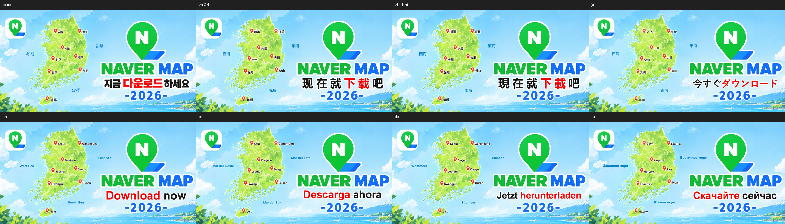

# 韩文地图：同底图七语适配与新知识

状态：partial。日期：2026-10-30。用户在当前会话明确认可“韩文地图”多轮翻译整体效果；[追加反馈](user-feedback.json)保存原话和本次可核对的输出哈希。partial指同一图种的有限覆盖和已披露minor，不抹除用户正向认可，也不表示七种语言均获逐字母语认证。

源图为1200×628的韩文NAVER地图广告，SHA256为`bbb19d9643efcf3715a99663ca8868d49ef31763c2c145f50c75be06725981d3`。标准译文含8个城市、3个海域和1条下载宣传语；NAVER MAP、N图标与年份保留。当前会话未读取“韩文地图”聊天全文；下述制作经过根据项目内真实文件、审核及用户当前说明复核。

## 本次复核范围

| 语言 | 当前原尺寸PNG | 宣传语 | 主要取舍 |
|---|---|---|---|
| 简体中文 | [zh-CN](evidence/zh-CN.png) | 现在就下载吧 | 保留黑红白边；共享底图水彩较平滑 |
| 繁体中文 | [zh-Hant](evidence/zh-Hant.png) | 現在就下載吧 | 爾/濟/載按实际字形重审，不能只换语言标签 |
| 日语 | [ja](evidence/ja.png) | 今すぐダウンロード | 假名字面比原韩文轻，白边比例更显眼 |
| 英语 | [en](evidence/en.png) | Download now | Gangneung展开至海面，仍保留图钉右侧关系 |
| 西班牙语 | [es](evidence/es.png) | Descarga ahora | Seúl重音保留，CTA与年份间留白较多 |
| 德语 | [de](evidence/de.png) | Jetzt herunterladen | 长词适应宽度后字高较低 |
| 俄语 | [ru](evidence/ru.png) | Скачайте сейчас | 长海域译名接近地图/品牌方向，仍留有空隙 |

[输出清单](outputs.json)含全部城市、海域、宣传语、SHA256和逐保护区结果。[原始设置](records/layout-settings.json)保存后五语实际坐标、字号和资产尺寸。主线实际查看了源图、简繁中、英西成图及相关字层/底图；[本轮独立观察](records/current-independent-observations.json)来自实际打开源图、日德俄原尺寸成图的独立子代理。另保留[当时五语合成独立复核](records/historical-independent-visual-review.json)，不将这些范围改写为对所有阶段或所有语言的母语认证。

## 新增可复用知识

完整步骤见[多语地图与描边字](../../methods/multilingual-map-lettering.md)，按地图/同图多语分支读取，维持provisional，不把本图参数推广为默认。

1. **强调色随语义迁移。** 下载动作在中文中段、英西俄句首、日德靠后；红色跟随实际下载片段，不跟随第几个字或固定横坐标。品牌色与译文强调分开。
2. **地图标签围绕锚点与空域。** 日语江陵资产宽38px、英语Gangneung宽95px，左缘均约502；東海宽45px、俄语Восточное море宽161px，围绕同一空域居中。不能把韩文旧文字框当成新文字硬宽上限；同时审地图侧、商标侧和邻名，不只审画布边界。
3. **等宽不等于同力度。** 日语CTA资产524×65、德语522×51、俄语518×56，宽度接近，字高/笔画仍不同。这些数是包含轮廓的实际资产尺寸，不是统一视觉高度或自动审美评分。既不横向压扁，也不只靠不断缩字号。
4. **描边颜色与字面分开。** [最初失败稿](evidence/failed-same-color-stroke.png)中的同色粗描边堵塞了地名和CTA字腔。之后显式白色外轮廓的RGBA文字素材恢复可读。大标题、小城市字和蓝色海域字分别设计；通用工具表达不了时采用明确资产路线，不把同色加粗当白边。
5. **繁简转换保留语义与字形复审。** 复用未变化资产，重新制作首爾/濟州/東海及現/載等变化文字；小字复杂笔画、轮廓和密度仍实际看图。不凭繁体标签、字体覆盖或文件存在推断字形正确，也不把中文直接转写当其他语言译名。
6. **共享背景也共享局限。** 七语背景字节都为`cc29e717ed84b413f96f4c58a7b526856c9a449135461b93d2b9f89ac0aca08b`，即[同一背景](evidence/background.png)。没有重复擦图，但宣传语后水彩平滑也随之继承。新语言有新语义/字层/合成审核；七个输出不是七次独立底图修复。
7. **导出格式单独绑定证据。** [英语JPEG交付副本](evidence/en-delivery.jpg)相对英语PNG有394,603个像素至少一个RGBA通道不同，其中品牌ROI有39,763个。五语JPEG在该ROI均有39,763个差异，详见[格式差异](records/export-differences.json)。这是有损压缩的数值结果，不是同等数量的可见缺陷；PNG保护区0变化的结论仅适用于PNG，不能套给JPEG。

## 本轮补充观察与原有认可

原海域韩文有明显斜势，多个目标版本使用直立字。旧style_comparisons仅列蓝色、轻量、无白色粗边，遗漏这一特征；本轮追加为轻微风格差异，提醒后续源图要求同时记录字轴/倾斜。没有为此改写旧要求、旧pass或用户认可，也没有擅自重做当前满意版本。

原下载宣传语背后的未知水彩细纹没有真实底稿可核对，现为更平滑的近似重建。日语字重、德语字高、长海域名间隙也保留可接受取舍。未发现明显缺字方框、整行裁切或品牌/年份相压；当前视觉审查不等于各语言译名规范、语法与地方使用习惯的完整认证。

## 技术与审核证据

本轮重新运行三组check-job，简体、繁体及后五语均pass；再对七张归档PNG逐一与源图直接比较，12个声明保护区（品牌、年份、两图标和8图钉）均0变化像素。范围外变化为当时回执记录0；本轮未把该数字扩大为所有非文字像素完全不变。

每语言的原始plan、receipt、self review和三组背景审核保存在[records](records/)。它们是只读证据快照，历史review中的not_recorded保持原样，后来的用户认可单独追加。新增[验证记录](validation.json)与[证据清单](evidence-manifest.json)绑定本轮文件和验证结果。本目录[Git属性](.gitattributes)禁用换行转换，保持这些证据在跨平台检出后的原始字节。

这些快照不是完整可执行准备包：制作现场的冻结包仍在各runs目录，原脚本使用本机Windows字体。保存的[初始背景/计划脚本文本](records/build_plan.py.txt)、[白描边素材脚本文本](records/make_lettering.py.txt)和JSON设置用于追溯，不宣称新环境一键重建七语。没有复制商业字体，也没有新增OCR/图片API调用。

## 与0.2.0的关系和适用边界

实际使用0.2.0任务快照、共享背景审核、region_map、visual_targets和逐版本证据检查；最终白描边来自本图Pillow资产，新的金色渐变/柔影并未直接参与这组最终外观。初稿失败也说明框架不会自动保证首次内部候选合格；效果来自约束、选路、实际看图与有依据的返工。

新知识只支持同一1200×628插画广告在CJK、拉丁、西里尔文字中的适配经验，不能视为新增七种图种、完全恢复所有隐藏纹理、摄影修复/密集地图/RTL/透视弧形能力或未来付费生成授权。用户整体认可与这些边界同时保留。
