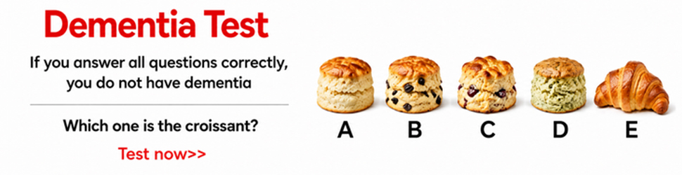
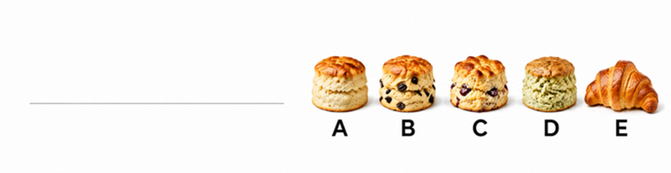
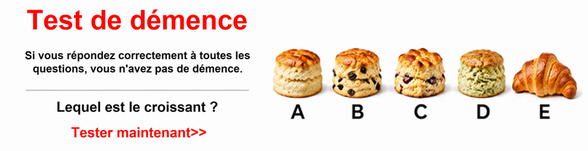

# 三来源十语970×250横幅

状态：partial。2026-11-11的SHE-20261111-028，UUID `a9ec328b-2582-5c43-a377-e88b5bd49f21`。案例保存单次交付事实和可复查样本，不代表用户已验收。

## 范围和结果

三张完整源图×繁中、西、葡、德、法、波、土、韩、日、荷十语，共30张，保持原生970×250；JPEG不超过153600字节。`delivery-snapshot.json`保留每个成员的审核/实际下载SHA、尺寸、字节、素材及资源ID；整理时重新读取本地两份文件核对，未重新向平台查询。

原执行记录的自审分数91.4–93.4，最终字节74763–116319；30项上传、入库和精确UUID绑定已读回核验。平台风险30项pending，需求业务状态not_started；用户验收未记录。原图包含“答对全部问题就没有痴呆”的断言，忠实翻译不构成医学验证或风险审批。

## 适用路线

源图左侧是标题、两行正文、问题、短按钮，右侧是答案图及A–E。前两张问最深色图形，第三张问哪个是牛角包；主题相近不代表问句相同。

浅底且待替换区域低纹理，可用现有 `sample_rows` 局部源像素重建，仅处理左侧文字。每个来源先单独审核背景，右侧身份和答案像素保留；十语复用该背景，各有独立透明文字层。此经验适用于同类低纹理横幅，摄影去字仍走[摄影背景修复](../../methods/photographic-background-repair.md)。

证据中的第三张源图、背景和当前法语成品：

## 失败与取舍

法语初稿按钮“Faire le test>>”遗漏原文“Test now>>”中的时间信息。修正为“Tester maintenant>>”，保留`source-3-fr-v1-rejected.jpg`，新文件重新审核、计算SHA后才进入最终矩阵；不能为行宽删减定稿或把旧审核迁移到新字节。

标题改为居中、替代粗体、语言引起的行长变化记录为minor；源2日文有短尾行，源3繁中/日文有术语跨行。原执行按可读、语义完整和80分底线交付，没有追求逐像素一致。中日文禁则/术语不拆分仅是待改进方向，未实现自动功能。

本次整理重新查看了本页三张图片；30张视觉观察来自原执行的逐文件自审，本轮不把重新哈希冒称重新完成30张视觉审核，也不把self说成独立审核。

## 复核与来源

- `evidence-manifest.json`列出随Git保存文件的实际SHA和字节，图片另记格式与像素；没有完整生产工作区也可复查代表样本。
- `delivery-snapshot.json`为30项本地实际文件核验的静态快照，`live_platform_rechecked=false`；不会随着平台后来变化自动更新。
- 本地完整证据位于`work/fireplay-production/SHE-20261111-028/`：`FINAL-DELIVERY-20261111.md`、`final-resource-matrix.json`、`reviews/`、`fresh-downloads/`、`publication-journal.jsonl`，不随Git检出。
- 归属以当时正式查询和当前素材详情为据：D361对应彭杭，上传操作人与设计师分开。名称后缀的本次结果仅是个案证据，不能替代下次查询。

范围、尺寸和通用五阶段规则分别维护在[图组与尺寸规划](../../methods/source-set-and-size-planning.md)、[分层方法](../../methods/layered-localization.md)和[交付评分](../../methods/delivery-balanced-review.md)，本案例不复制其正文。
