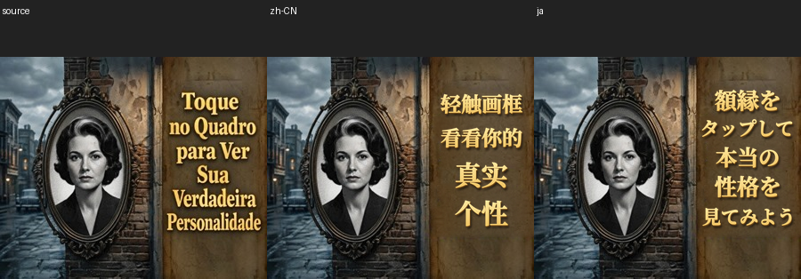

# 原生观感工具的真实双语回归

日期：2026-10-30。此目录是新版本证据，不覆盖历史修订或用户反馈。Agent结论为可交付、带minor；用户验收未记录，案例继续partial。

[中文成图](chinese.png) / [日文成图](japanese.png) / [独立背景](background.png)。源图仍为[原归档](../evidence/source.png)，300×250。当前中文SHA256为`d9dc13e7035bfa2cf4bd514d79529175ac175b006a5089e8e0d72449c23c9628`；日文为`60ad7a987f111740f4124c6c6cef4489b5ab6769f4d41e462a308a3491eda3f5`。

## 变化及观察

- 先前个案的字面、接触暗边、浅立体、柔影和高光进入通用配置模块；独立输出各组件，真实原尺寸比较其深度，不因配置有shadow就放行。
- 中日定稿逐区绑定所有实际行；任何错字、漏区、数字符号变化或错语言产物会被相应合同拦截。语义保留区自动合并到全局保护。
- 共享背景独立审核后才排字，冻结源图、语义、字体、素材及许可；清单包含完整依赖，复制语言目录不能冒充另一种语言。
- 旧墙面规整竖纹实际可见。本轮先试局部字/影蒙版内的边界传播、邻近真墙残差随机patch和低频先验，再因左缘亮块返工固定可信源墙边界。最终未见可辨葡文、完整矩形硬边、周期竖纹或原亮块。

字效与上一轮已经改善的版本接近，没有证据宣称又有显著风格跃升。本轮新增重点是复用能力、可靠的阶段/文本/版本检查，以及墙面连续性改善。中文四行上密下疏、日文第一行复杂汉字略密，均保留minor建议；没有为凑行宽扩义或横向强拉字形。

## 真实审核与限制

[中文自审](chinese-self-review.json)、[日文自审](japanese-self-review.json)与[独立视觉复核](independent-review.json)分开保存。[背景审核](background-review.json)先于本轮排字；当前[门禁快照](quality.json)两语言pass，附minor。独立审核者实际查看16张源/旧图/阶段/当前图，又重新打开当前v2两张成图核对哈希；其结论不代表用户验收。

当前实际保护统计：肖像/画框/街景左182列、上墙和下墙三个保护区，两语言均0变化像素。统计只证明声明区域未变；视觉连续性另有实际看图。

被原文遮住的灰泥没有可验证的真实底稿。新底图是视觉可信的近似补全，放大纹理更均匀细碎，上下色调变化仍可挑剔；隐藏纹理忠实性为uncertain，不能称恢复了原始被遮住的像素。用户此前“目前确实好了一些”仅绑定历史修订，没有迁移到本轮。

## 复现与自动验证

用[相对路径中日任务](../../../../examples/trueself-job.json)和[指南](../../../../docs/native-workflow.md)prepare→实际背景审核→render→实际逐语言审核→check。不需要作者机器的run/work或系统字体；随项目的开放字体子集只覆盖本示例用字，新文本需完整字体。

阶段目录是`runs/product-native-20261030/prepared-v2`与`render-v2`。它们保留活输入/字体/输出回执；此归档是定版观察快照，不是可直接check-job的阶段目录。移动冻结包后从其中job.json重新prepare，得到新回执与空审核，不能复用旧绝对路径pass。

[验证记录](validation.json)记录153项测试、五例技术预期回归和本轮CLI结果。[五例配置](../../../../examples/visual-regressions.json)保留旧平字、当前图和真实保护损坏；4技术pass/1技术fail符合预期，benchmark自身的视觉状态始终pending。它不会自动看出字平，只保留有来源的缺陷标签。[对照配置](../../../../examples/trueself-comparison.json)可重建本页整图/局部和精确变化mask。

[证据清单](evidence-manifest.json)绑定本轮归档字节；[背景方法记录](background-method.md)保留已观察缺陷、换路线原因和近似边界。没有新图片模型/OCR/API调用，没有改变历史反馈、失败图或旧审核。
